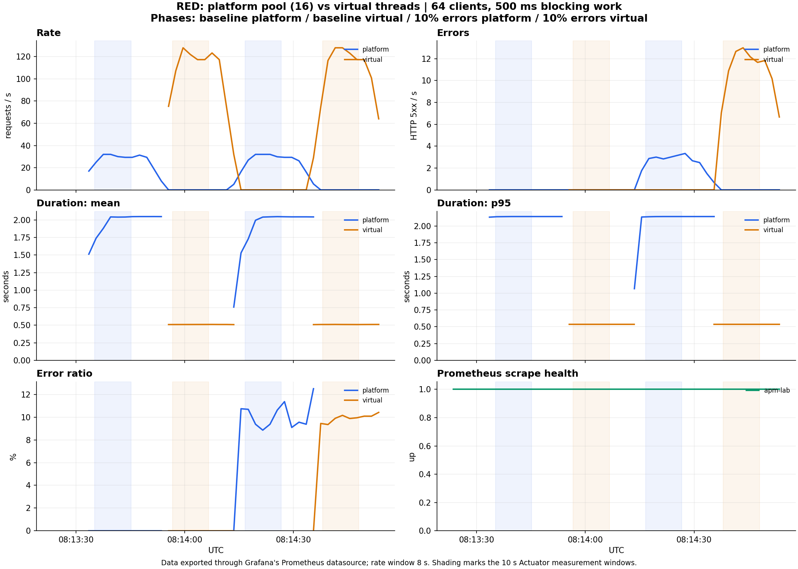

# Результаты измерения пропускной способности и RED

Выполнено: 2026-11-07T08:13:28.525204+00:00 — 2026-11-07T08:14:51.507433+00:00 (UTC).
Среда клиента: Windows-11-10.0.26200-SP0.
Prometheus 3.16.0; Grafana OSS 13.3.0.

## Методика

Один процесс приложения, Java 21, Spring Boot 3.5.7, 64 параллельных клиентов, блокирующее ожидание 500 мс. Обычный пул — 16 потоков; виртуальный исполнитель создаёт поток на задачу. Операция и HTTP-транспорт общие.
Перед каждым окном — 6 с прогрева. Между двумя чтениями Actuator — целевые 10 секунд. После каждого прогона все оставшиеся запросы завершены.
Только завершённые GET-запросы выбранного URI: `/actuator/metrics/http.server.requests?tag=uri:/work/{mode}&tag=method:GET`.
Основные два замера не содержат инъекции ошибок. Фазы `errors` выполнены отдельно для проверки панели Errors.

## COUNT и пропускная способность

| Потоки | COUNT₁ | COUNT₂ | ΔCOUNT | Реальное окно, с | ΔCOUNT / 10, req/s | ΔCOUNT / Δt, req/s |
| --- | ---: | ---: | ---: | ---: | ---: | ---: |
| platform | 177 | 497 | 320 | 10.001464 | 32.000 | 31.995 |
| virtual | 705 | 1985 | 1280 | 10.000961 | 128.000 | 127.988 |

Отношение virtual/platform: **4.000×**. Изменение пропускной способности: **300.0%**.

Фактические рабочие потоки из ответов приложения:

```json
{
  "platform": {
    "delayMs": 500,
    "thread": "platform-worker-0",
    "virtual": false
  },
  "virtual": {
    "delayMs": 500,
    "thread": "virtual-worker-0",
    "virtual": true
  }
}
```

## Графики Grafana

[Открыть dashboard в абсолютном диапазоне выполненного прогона](http://127.0.0.1:3000/d/apm-red?from=1794039203525&to=1794039296507&refresh=).

Изображение построено по данным панелей через источник Grafana; это не снимок UI. Интерфейс браузера в среде автоматизации недоступен, поэтому визуальная проверка выполнена для экспортированного графика, а подключение dashboard проверено через API.
Источник данных Prometheus и dashboard загружены provisioning-механизмом. Target apm-lab имеет health=up. Числа ниже получены через HTTP proxy источника данных Grafana теми же PromQL-запросами, что используют панели, в конце каждого 10-секундного окна; окно rate — 8 секунд.

| Фаза | Потоки | Rate, req/s | 5xx, req/s | 5xx, % | Mean Duration, с | p95 Duration, с |
| --- | --- | ---: | ---: | ---: | ---: | ---: |
| baseline | platform | 29.333 | 0.000 | 0.000 | 2.046 | 2.140 |
| baseline | virtual | 123.333 | 0.000 | 0.000 | 0.511 | 0.535 |
| errors | platform | 29.333 | 3.333 | 11.364 | 2.045 | 2.140 |
| errors | virtual | 117.333 | 11.833 | 10.085 | 0.511 | 0.535 |

### Rate

COUNT показывает 31.995 req/s у обычного пула и 127.988 req/s у виртуального исполнителя. На графике видны последовательные плато нагрузки и спад после завершения фаз. Ограничение обычного пула для этой операции — примерно 16 / 0.5 = 32 req/s; для 64 клиентов без ожидания рабочего потока — до 64 / 0.5 = 128 req/s до накладных расходов. Prometheus rate — оценка по scrape-снимкам; она может отличаться от разности Actuator COUNT за другое окно.

### Errors

В основных фазах ошибок нет. В отдельных фазах errors каждый клиент отправляет каждый десятый запрос с fail=true: сервер выполняет ту же операцию и возвращает 503. На графиках появляются ненулевые 5xx/s и доля около 10%. Это управляемая инъекция, а не доказательство ненадёжности виртуальных или обычных потоков. Число ошибок в секунду зависит также от общей Rate.

### Duration

Среднее время по разности Actuator TOTAL_TIME/COUNT в основных окнах: platform — 2.043 с, virtual — 0.511 с. При 64 клиентах и 16 обычных рабочих потоках запросы ждут очередь: примерно четыре группы по 500 мс, поэтому полное серверное время приближается к 2 с. У виртуальных потоков ожидание рабочего потока существенно меньше, а блокирующая операция по-прежнему занимает 500 мс. p95 рассчитан по гистограмме и зависит от границ bucket; это приближённое значение. Провалы и разрывы при отсутствии трафика ожидаемы.

## Проверки и ограничения

* Maven verify: 3 интеграционных теста, без ошибок. Проверены типы потоков, рост COUNT, Prometheus histogram, HTTP 400 и 503.
* Grafana /api/health, provisioning dashboard, datasource и Prometheus target проверены.
* В нагрузочном скрипте не зарегистрированы транспортные/неожиданные HTTP-ошибки.
* Docker Compose прошёл проверку конфигурации. В этом окружении Docker daemon не был запущен; фактический прогон выполнен локальными Windows-процессами.
* Это один локальный прогон синтетической блокирующей I/O-модели, а не универсальный коэффициент ускорения. Размер обычного пула влияет на результат; вычислительная CPU-нагрузка требует отдельного эксперимента.
* Пропускная способность учитывает завершения внутри окна, в том числе запросы, начатые до него. Это стационарный замер, а не тест времени запуска.
* COUNT и TOTAL_TIME читаются последовательно; при непрерывном трафике средняя Duration из их разностей имеет небольшую погрешность.

## Артефакты

* [benchmark.json](benchmark.json) — исходные снимки Actuator, UTC, COUNT, интервалы, статусы.
* [monitoring.json](monitoring.json) — targets, Grafana health, результаты PromQL и временные ряды.
* [Конфигурация dashboard](../monitoring/grafana/dashboards/apm-red.json).
* [Команды воспроизведения и официальные источники](../README.md).

## Отдельная проверка долгих запросов

После нагрузочных замеров выполнены одиночные запросы с delayMs=5000. Они находятся за пределами измеренных окон:

| Метод | HTTP | Длительность клиента, с | virtual |
| --- | ---: | ---: | --- |
| platform | 200 | 5.040 | False |
| virtual | 200 | 5.039 | True |

[Исходные ответы долгих запросов](long-requests.json).
