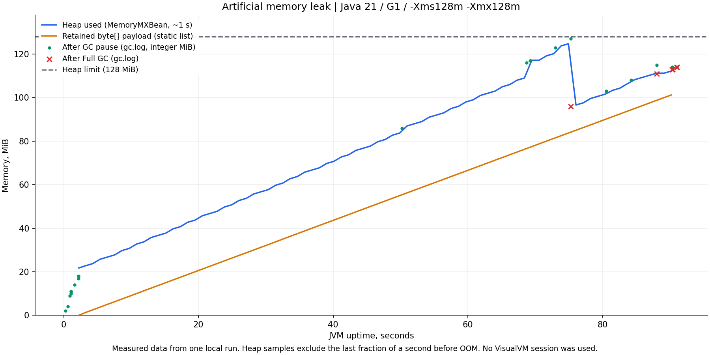

# Результаты измерений APM: пропускная способность, RED и GC

Замер пропускной способности и RED: 2026-11-07T08:13:28.525204+00:00 — 2026-11-07T08:14:51.507433+00:00 (UTC).
Среда клиента: Windows-11-10.0.26200-SP0.
Prometheus 3.16.0; Grafana OSS 13.3.0.

## Методика

Один процесс приложения, Java 21, Spring Boot 3.5.7, 64 параллельных клиентов, блокирующее ожидание 500 мс. Обычный пул — 16 потоков; виртуальный исполнитель создаёт поток на задачу. Операция и HTTP-транспорт общие.
Перед каждым окном — 6 с прогрева. Между двумя чтениями Actuator — целевые 10 секунд. После каждого прогона все оставшиеся запросы завершены.
Только завершённые GET-запросы выбранного URI: `/actuator/metrics/http.server.requests?tag=uri:/work/{mode}&tag=method:GET`.
Основные два замера не содержат инъекции ошибок. Фазы `errors` выполнены отдельно для проверки панели Errors.

## COUNT и пропускная способность

| Потоки | COUNT₁ | COUNT₂ | ΔCOUNT | Реальное окно, с | ΔCOUNT / 10, req/s | ΔCOUNT / Δt, req/s |
| --- | ---: | ---: | ---: | ---: | ---: | ---: |
| platform | 177 | 497 | 320 | 10.001464 | 32.000 | 31.995 |
| virtual | 705 | 1985 | 1280 | 10.000961 | 128.000 | 127.988 |

Отношение virtual/platform: **4.000×**. Изменение пропускной способности: **300.0%**.

Фактические рабочие потоки из ответов приложения:

```json
{
  "platform": {
    "delayMs": 500,
    "thread": "platform-worker-0",
    "virtual": false
  },
  "virtual": {
    "delayMs": 500,
    "thread": "virtual-worker-0",
    "virtual": true
  }
}
```

## Графики Grafana

[Открыть dashboard в абсолютном диапазоне выполненного прогона](http://127.0.0.1:3000/d/apm-red?from=1794039203525&to=1794039296507&refresh=).

Изображение построено по данным панелей через источник Grafana; это не снимок UI. Интерфейс браузера в среде автоматизации недоступен, поэтому визуальная проверка выполнена для экспортированного графика, а подключение dashboard проверено через API.
Источник данных Prometheus и dashboard загружены provisioning-механизмом. Target apm-lab имеет health=up. Числа ниже получены через HTTP proxy источника данных Grafana теми же PromQL-запросами, что используют панели, в конце каждого 10-секундного окна; окно rate — 8 секунд.

| Фаза | Потоки | Rate, req/s | 5xx, req/s | 5xx, % | Mean Duration, с | p95 Duration, с |
| --- | --- | ---: | ---: | ---: | ---: | ---: |
| baseline | platform | 29.333 | 0.000 | 0.000 | 2.046 | 2.140 |
| baseline | virtual | 123.333 | 0.000 | 0.000 | 0.511 | 0.535 |
| errors | platform | 29.333 | 3.333 | 11.364 | 2.045 | 2.140 |
| errors | virtual | 117.333 | 11.833 | 10.085 | 0.511 | 0.535 |

### Rate

COUNT показывает 31.995 req/s у обычного пула и 127.988 req/s у виртуального исполнителя. На графике видны последовательные плато нагрузки и спад после завершения фаз. Ограничение обычного пула для этой операции — примерно 16 / 0.5 = 32 req/s; для 64 клиентов без ожидания рабочего потока — до 64 / 0.5 = 128 req/s до накладных расходов. Prometheus rate — оценка по scrape-снимкам; она может отличаться от разности Actuator COUNT за другое окно.

### Errors

В основных фазах ошибок нет. В отдельных фазах errors каждый клиент отправляет каждый десятый запрос с fail=true: сервер выполняет ту же операцию и возвращает 503. На графиках появляются ненулевые 5xx/s и доля около 10%. Это управляемая инъекция, а не доказательство ненадёжности виртуальных или обычных потоков. Число ошибок в секунду зависит также от общей Rate.

### Duration

Среднее время по разности Actuator TOTAL_TIME/COUNT в основных окнах: platform — 2.043 с, virtual — 0.511 с. При 64 клиентах и 16 обычных рабочих потоках запросы ждут очередь: примерно четыре группы по 500 мс, поэтому полное серверное время приближается к 2 с. У виртуальных потоков ожидание рабочего потока существенно меньше, а блокирующая операция по-прежнему занимает 500 мс. p95 рассчитан по гистограмме и зависит от границ bucket; это приближённое значение. Провалы и разрывы при отсутствии трафика ожидаемы.

## Проверки и ограничения

* Maven verify: 3 интеграционных теста, без ошибок. Проверены типы потоков, рост COUNT, Prometheus histogram, HTTP 400 и 503.
* Grafana /api/health, provisioning dashboard, datasource и Prometheus target проверены.
* В нагрузочном скрипте не зарегистрированы транспортные/неожиданные HTTP-ошибки.
* Docker Compose прошёл проверку конфигурации. В этом окружении Docker daemon не был запущен; фактический прогон выполнен локальными Windows-процессами.
* Это один локальный прогон синтетической блокирующей I/O-модели, а не универсальный коэффициент ускорения. Размер обычного пула влияет на результат; вычислительная CPU-нагрузка требует отдельного эксперимента.
* Пропускная способность учитывает завершения внутри окна, в том числе запросы, начатые до него. Это стационарный замер, а не тест времени запуска.
* COUNT и TOTAL_TIME читаются последовательно; при непрерывном трафике средняя Duration из их разностей имеет небольшую погрешность.

## Артефакты

* [benchmark.json](benchmark.json) — исходные снимки Actuator, UTC, COUNT, интервалы, статусы.
* [monitoring.json](monitoring.json) — targets, Grafana health, результаты PromQL и временные ряды.
* [Конфигурация dashboard](../monitoring/grafana/dashboards/apm-red.json).
* [Команды воспроизведения и официальные источники](../README.md).

## Отдельная проверка долгих запросов

После нагрузочных замеров выполнены одиночные запросы с delayMs=5000. Они находятся за пределами измеренных окон:

| Метод | HTTP | Длительность клиента, с | virtual |
| --- | ---: | ---: | --- |
| platform | 200 | 5.040 | False |
| virtual | 200 | 5.039 | True |

[Исходные ответы долгих запросов](long-requests.json).

<!-- GC-EXPERIMENT -->

## Эксперимент с утечкой памяти и GC (2026-11-14)

Фактический прогон: **08:48:07.259534–08:49:38.842276 UTC**
(11:48:07–11:49:38, Europe/Istanbul), Windows, Oracle HotSpot Java **21.0.1**,
Spring Boot 3.5.7, G1. PID JVM — 34368.
Это отдельный эксперимент; числа RED выше относятся к 2026-11-07.

### Шаг 1. Включение GC-логирования

Приложение запущено с параметрами:

```text
-Xms128m -Xmx128m -XX:+UseG1GC -XX:+ExitOnOutOfMemoryError
-Xlog:gc*,safepoint:file=gc.log:time,uptime,level,tags:filecount=0
```

Начальный и максимальный heap — 128 МиБ. `gc*` включает подробные сообщения
GC, `safepoint` — остановки JVM; `time,uptime` сохраняют абсолютное время и
секунды от старта JVM. Ротация отключена, весь прогон находится в одном
[gc.log](gc.log). Рабочий каталог JVM — `reports`.
Параметры логирования описаны в [официальной документации Java 21](https://docs.oracle.com/en/java/javase/21/docs/specs/man/java.html#enable-logging-with-the-jvm-unified-logging-framework).

### Шаг 2. Искусственная утечка

Добавлен [MemoryLeakExperiment.java](../src/main/java/org/example/MemoryLeakExperiment.java),
активный только при `--spring.profiles.active=gc-leak`:

```java
private static final List<byte[]> RETAINED = new ArrayList<>();
// В цикле нагрузки:
RETAINED.add(new byte[128 * 1024]);
Thread.sleep(100);
```

Список не очищается. Цепочка достижимости:
статическое поле `RETAINED` → `ArrayList` → массив ссылок → `byte[]`.
Сильные ссылки удерживают все добавленные массивы. Номинальная скорость
накопления полезных данных — 1.25 МиБ/с; заголовки объектов, сам список и
память Spring Boot расходуют дополнительный heap. Фактическая скорость
зависит от длительности `sleep`, работы GC и планировщика ОС.

### Шаг 3. Запуск под нагрузкой

После `mvnw verify` из корня проекта выполнено:

```powershell
python scripts/gc_experiment.py
python scripts/plot_gc.py
```

[Скрипт запуска](../scripts/gc_experiment.py) создаёт отдельную JVM с указанными
параметрами и портом `127.0.0.1:18080`. Нагрузка — внутренний цикл выделения
массивов; внешние HTTP-клиенты не требуются. Скрипт ограничивает время
работы 150 секундами, сохраняет исходные данные и проверяет результат.
Подробные команды сборки и установки библиотеки графиков — в [README](../README.md#утечка-памяти-и-gc).

| Измерение | Результат |
| --- | ---: |
| От запуска процесса до завершения | **91.562 с** |
| Начало нагрузки, uptime JVM | 2.232 с |
| Интервал между первым и последним образцом heap | 88.010 с |
| Образцы heap (примерно раз в секунду) | 82 |
| Последний образец: число удерживаемых массивов | 810 |
| Последний образец: полезные данные массивов | 101.25 МиБ |
| Максимальный sampled heap used | 124.75 МиБ |
| Завершённые паузы GC, включая Remark/Cleanup | 30 |
| Из них Full GC | 6 |
| Код завершения JVM | 3 |

Причина завершения в [логе приложения](gc-application.log):

```text
Terminating due to java.lang.OutOfMemoryError: Java heap space
```

Heap исчерпан примерно за **1 минуту 32 секунды** — требуемые 1–2 минуты.
`ExitOnOutOfMemoryError` завершил экспериментальный процесс; тайм-аут
скрипта не срабатывал. Последний образец CSV предшествует OOM,
поэтому 810 массивов — число на момент этого образца.

### Шаг 4. Анализ GC-лога

Выбранные завершённые сборки из [gc.log](gc.log):

| Uptime, с | GC | Тип | До, МиБ | После, МиБ | Освобождено, МиБ | Пауза, мс |
| ---: | ---: | --- | ---: | ---: | ---: | ---: |
| 1.606 | 5 | Young, запуск Spring Boot | 80 | 14 | 66 | 5.475 |
| 50.226 | 8 | Young, Evacuation Failure | 85 | 86 | −1 | 4.751 |
| 75.299 | 14 | Full, G1 Compaction Pause | 127 | 96 | 31 | 29.409 |
| 88.054 | 19 | Full, G1 Compaction Pause | 115 | 111 | 4 | 10.779 |
| 90.363 | 22 | Full, G1 Compaction Pause | 114 | 113 | 1 | 11.462 |
| 90.376 | 23 | Full, G1 Compaction Pause | 113 | 113 | 0 | 13.372 |
| 91.044 | 25 | Full, G1 Compaction Pause | 114 | 114 | 0 | 9.154 |
| 91.056 | 26 | Full, G1 Compaction Pause | 114 | 114 | 0 | 11.868 |

`M` в GC-логе соответствует МиБ. Значения до/после показаны с точностью
до целых МиБ; разность 0 означает отсутствие видимого освобождения
на этой шкале. При Evacuation Failure величина used может даже увеличиться;
отрицательное «освобождено» здесь — фактическая разность показаний.

**Освобождается ли память после GC? Частично — да.** В начале Young GC
освободил 66 МиБ временных объектов, а первый Full GC — 31 МиБ.
Однако объём памяти после последовательных Full GC растёт:
**96 → 111 → 113 → 113 → 114 → 114 МиБ**. Последние две полные сборки
уже не снижают его на целочисленной шкале лога и не предотвращают OOM.
Удерживаемые статическим списком массивы остаются достижимыми и не удаляются.
Таким образом, сборщик работает, но искусственная утечка сохраняется.

Почему OOM при 114M, хотя лимит — 128M: в конце лог показывает
`Old regions: 128->128`, `Eden regions: 0->0(0)` и
`Humongous regions: 0->0`. Размер региона — 1 МиБ, заняты все 128 регионов.
Свободные остатки внутри регионов не равны свободному месту для нового
массива; наблюдаются Evacuation Failure и попытки полной компактизации.
Это согласуется с [описанием работы G1 при недостатке свободных регионов](https://docs.oracle.com/en/java/javase/21/gctuning/garbage-first-g1-garbage-collector1.html).
Нулевое число humongous-регионов также показывает, что этот сценарий
не использует humongous-объекты.

Для устранения такой утечки нужно прекратить неограниченное накопление:
удалять ненужные ссылки либо ограничить объём/срок жизни коллекции.
Увеличение `-Xmx` лишь отложит OOM при сохранении текущего цикла.

### График heap и проверка



График построен по фактическим данным `MemoryMXBean.getHeapMemoryUsage()`
из [heap.csv](heap.csv) и завершённым паузам из GC-лога. Синяя линия — heap
used, оранжевая — только полезные данные удерживаемых массивов, зелёные
точки — память после пауз GC, красные кресты — после Full GC.
Видны накопление данных, кратковременный спад при первом Full GC и
продолжение роста. Время на всех рядах — uptime одной JVM.
VisualVM/внешний профайлер в этом прогоне не подключался; опциональный
способ подключения описан в README. Изображение — экспорт измерений,
а не снимок интерфейса профайлера.

Проверки: `mvnw --offline clean verify` — **4 теста, 0 ошибок**, включая
отсутствие компонента утечки без специального профиля. Скрипт подтвердил
OOM, Full GC, рост удерживаемых данных и длительность 60–120 секунд.
JVM завершена, процесс эксперимента не оставлен работающим.

Артефакты: [gc.log](gc.log), [лог приложения](gc-application.log),
[heap.csv](heap.csv), [gc-experiment.json](gc-experiment.json),
[график](gc-heap.png), [скрипт графика](../scripts/plot_gc.py).
